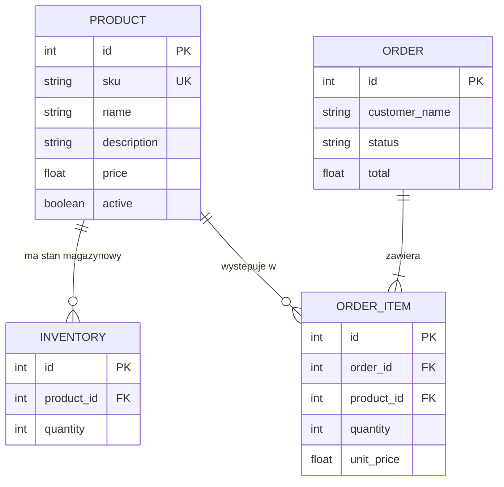

# Rozproszony sklep internetowy

Projekt przedstawia prosty sklep internetowy z dwoma oddziałami: **Katowice** i **Kraków**. Aplikacja wykorzystuje rozproszenie danych pomiędzy dwa niezależne węzły PostgreSQL.

## Technologie

- Python 3.11
- Starlette
- Uvicorn
- Graphene i GraphQL
- PonyORM
- PostgreSQL 16
- Docker Compose

## Architektura

System składa się z trzech głównych usług:

- `api` – backend Starlette z endpointem GraphQL,
- `postgres_katowice` – baza danych oddziału Katowice,
- `postgres_krakow` – baza danych oddziału Kraków.

Serwis `seed_database` jednorazowo dodaje przykładowe dane do obu węzłów. Katalog produktów jest utrzymywany w obu bazach, natomiast stany magazynowe i zamówienia są obsługiwane lokalnie w wybranym oddziale.

## Encje



### Opis encji

- **Product** – współdzielony katalog produktów.
- **Inventory** – liczba sztuk produktu dostępna w danym węźle.
- **Order** – zamówienie klienta zapisane lokalnie w wybranym oddziale.
- **OrderItem** – produkt i liczba sztuk wchodząca w skład zamówienia.

## Rozmieszczenie danych

| Węzeł | Dane |
|---|---|
| Katowice | produkty, stany magazynowe Katowic, zamówienia Katowic |
| Kraków | produkty, stany magazynowe Krakowa, zamówienia Krakowa |

Produkty są zapisywane w obu bazach, dzięki czemu każdy oddział ma dostęp do katalogu. Magazyn i zamówienia są rozdzielone lokalnie, co pozwala niezależnie obsługiwać oddziały.

## Uruchomienie przez Docker

Wymagane są Docker i Docker Compose.

```bash
docker compose up --build
```

Uruchomienie tworzy:

1. dwie bazy PostgreSQL,
2. tabele przez PonyORM,
3. przykładowe dane przez `seed_database`,
4. backend API.

API i GraphiQL są dostępne pod:

```text
http://localhost:8000/graphql
```

Health check:

```text
http://localhost:8000/health
```

Zatrzymanie kontenerów:

```bash
docker compose down
```

Zatrzymanie wraz z usunięciem danych baz:

```bash
docker compose down -v
```

## Uruchomienie lokalne przez F5

Lokalnie aplikacja korzysta z dwóch baz SQLite zapisanych w katalogu `data/`.

Najpierw należy zainstalować zależności:

```bash
pip install -r requirements.txt
```

Następnie można uruchomić aplikację przez F5 w VS Code albo poleceniem:

```bash
python backend/app.py
```

Lokalny seed:

```bash
python -m backend.seed_database
```

Domyślnie lokalny backend działa pod:

```text
http://127.0.0.1:8000/graphql
```

## Przykładowe zapytanie GraphQL

```graphql
{
  products {
    sku
    name
    price
  }
  inventory {
    node
    quantity
    product {
      sku
      name
    }
  }
}
```

## Przydatne polecenia

Wyświetlenie statusu usług:

```bash
docker compose ps
```

Logi API:

```bash
docker compose logs -f api
```

Logi seeda:

```bash
docker compose logs seed_database
```