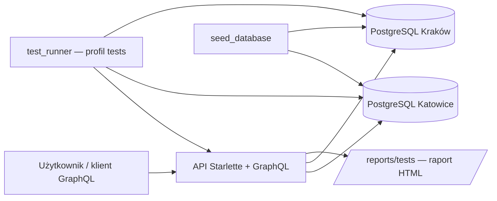
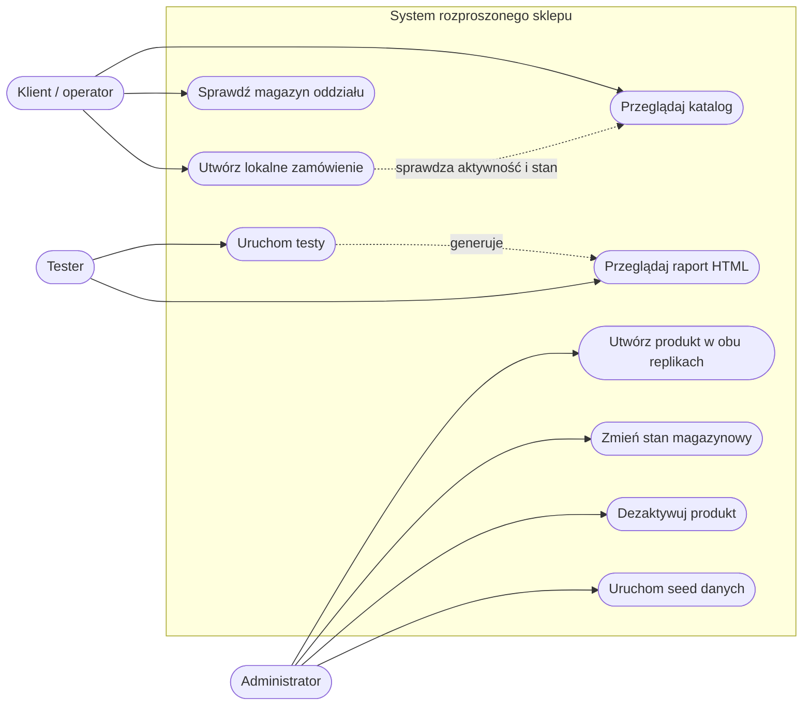
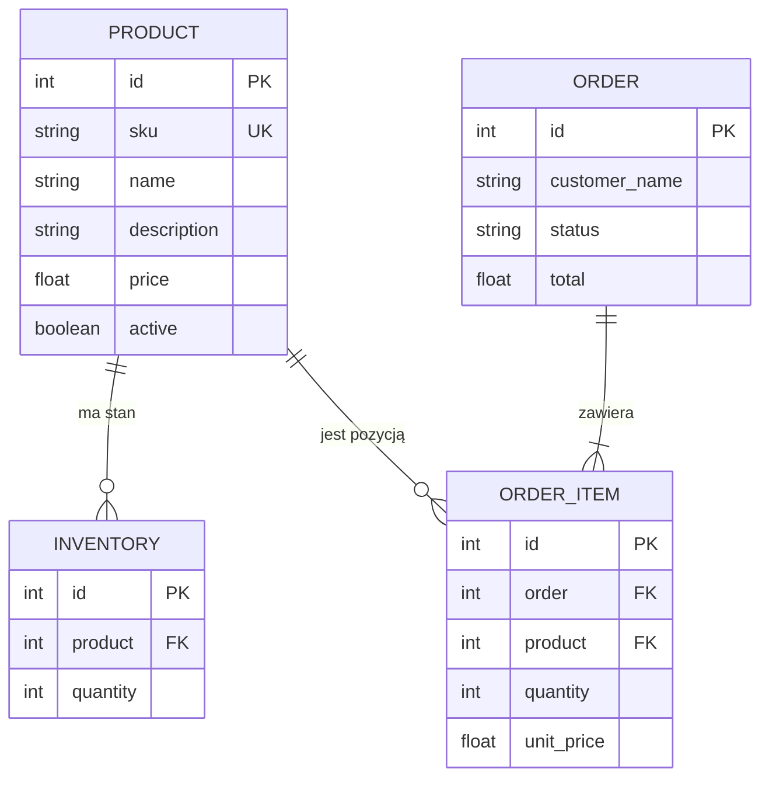

# Sprawozdanie — rozproszony sklep internetowy

## 1. Cel i opis problemu

Celem projektu jest implementacja prostego systemu sklepu internetowego, w którym dane są rozdzielone pomiędzy dwa niezależne oddziały: **Katowice** i **Kraków**. System ma umożliwiać wspólne zarządzanie katalogiem produktów przy zachowaniu lokalności danych operacyjnych: stanów magazynowych i zamówień.

Rozwiązany problem polega na pogodzeniu dwóch wymagań:

- produkt powinien być widoczny w obu oddziałach, ponieważ katalog jest wspólny;
- zmiana liczby sztuk lub utworzenie zamówienia powinna dotyczyć tylko wybranego oddziału.

System realizuje to przez replikację katalogu w dwóch bazach PostgreSQL. Każda baza zawiera własne rekordy magazynowe i zamówienia. API udostępnia jednolity interfejs GraphQL, przez który klient wybiera oddział podczas operacji lokalnych.

## 2. Architektura systemu

System składa się z następujących usług Docker Compose:

| Usługa | Odpowiedzialność |
|---|---|
| `api` | aplikacja Starlette z endpointem GraphQL i endpointem raportu testów |
| `postgres_katowice` | niezależna baza PostgreSQL oddziału Katowice |
| `postgres_krakow` | niezależna baza PostgreSQL oddziału Kraków |
| `seed_database` | jednorazowe, idempotentne zasilenie obu baz danymi demonstracyjnymi |
| `test_runner` | opcjonalny kontener uruchamiający testy bez scenariusza awarii |



Backend został napisany w Pythonie 3.11. Warstwa HTTP używa Starlette i Uvicorn, API GraphQL — Graphene, a mapowanie encji — PonyORM. W środowisku Docker dane są przechowywane w PostgreSQL 16. Dla lokalnego uruchomienia bez Dockera używane są dwa pliki SQLite.

## 3. Wymagania funkcjonalne

1. System udostępnia listę aktywnych produktów.
2. System pozwala odczytać stan magazynowy jednego albo obu oddziałów.
3. System pozwala odczytać zamówienia jednego albo obu oddziałów.
4. Dodanie produktu tworzy produkt i rekord magazynowy w obu bazach.
5. Aktualizacja magazynu dotyczy tylko wskazanego oddziału.
6. Utworzenie zamówienia zmniejsza stan magazynowy tylko w wybranym oddziale.
7. Zamówienie może zawierać wyłącznie istniejące, aktywne produkty w ilości większej od zera i nieprzekraczającej stanu magazynowego.
8. Usunięcie produktu jest logiczne: ustawia `active=false` w obu replikach katalogu.
9. Jeśli jedna replika katalogu jest niedostępna, operacja utworzenia lub logicznego usunięcia produktu kończy się błędem bez częściowej zmiany katalogu.
10. Seed tworzy brakujące dane demonstracyjne bez nadpisywania istniejących stanów magazynowych i flag `active`.
11. System generuje raport testów w HTML, JSON i CSV oraz udostępnia HTML pod endpointem HTTP.

## 4. Wymagania niefunkcjonalne

| Obszar | Wymaganie i realizacja |
|---|---|
| Dostępność | Dane Katowic pozostają możliwe do odczytu przy niedostępności Krakowa. |
| Spójność katalogu | Mutacje katalogowe najpierw sprawdzają oba węzły, a następnie wykonują zapis we wspólnej sesji ORM. |
| Izolacja danych | Magazyny i zamówienia nie są replikowane między oddziałami. |
| Powtarzalność | Seed oraz testy posługują się deterministycznymi lub prefiksowanymi danymi. |
| Obserwowalność | Dostępne są `/health`, logi Docker Compose i raport testowy HTML. |
| Przenośność | Aplikację można uruchomić przez Docker Compose albo lokalnie z SQLite. |
| Czytelność i utrzymanie | Testy są rozdzielone na scenariusze, konfigurację, adaptery infrastruktury, generator danych i renderer raportu. |
| Bezpieczeństwo danych | Testowe SKU `PERF-*` i `CONS-*` są usuwane po teście; reset wolumenów wymaga jawnego polecenia. |

## 5. Diagram przypadków użycia UML



## 6. Trzy scenariusze użycia

### SC-01 — Dodanie produktu do wspólnego katalogu

**Aktor:** administrator.  
**Warunek wstępny:** obie bazy katalogowe są dostępne, a SKU nie występuje w żadnej z nich.

1. Administrator wysyła mutację `createProduct` z SKU, nazwą, opisem i ceną.
2. API sprawdza dostępność obu replik oraz brak produktu o tym SKU.
3. API tworzy produkt i stan magazynowy `0` w Katowicach.
4. API tworzy produkt i stan magazynowy `0` w Krakowie.
5. API zwraca `ok=true`.

**Rezultat:** produkt jest dostępny w obu katalogach. Jeśli dowolny węzeł jest niedostępny, mutacja zwraca błąd i nie powinna pozostawić produktu tylko w jednym katalogu.

### SC-02 — Utworzenie zamówienia w Katowicach

**Aktor:** klient.  
**Warunek wstępny:** wskazany produkt istnieje, ma `active=true`, a stan Katowic jest wystarczający.

1. Klient wysyła `createOrder` z `node: "KATOWICE"`, danymi klienta i listą pozycji.
2. API sprawdza dodatnią ilość, istnienie produktu, flagę `active` oraz stan Katowic.
3. API tworzy `Order` i `OrderItem` w bazie Katowic.
4. API zmniejsza tylko rekord `Inventory` Katowic.
5. API oblicza i zapisuje kwotę całkowitą zamówienia.

**Rezultat:** zamówienie nie jest kopiowane do Krakowa, a krakowski stan magazynowy nie zmienia się.

### SC-03 — Wykonanie testów i podgląd raportu

**Aktor:** tester.  
**Warunek wstępny:** działają API i bazy danych.

1. Tester uruchamia `python -m Tests.run_tests` albo kontener `test_runner`.
2. Runner czeka na dostępność API i uruchamia scenariusze testowe.
3. Generator tworzy dane tymczasowe `PERF-*` oraz po testach je usuwa.
4. Renderer zapisuje `report.html`, `report.json` i `measurements.csv`.
5. Tester otwiera `http://localhost:8000/reports/tests`.

**Rezultat:** tester otrzymuje czytelny raport PASS/FAIL z pomiarami i wnioskami.

## 7. Diagram bazy danych (ERD)

Każdy węzeł posiada ten sam schemat relacyjny.



| Encja | Znaczenie |
|---|---|
| `Product` | element współdzielonego katalogu, identyfikowany przez unikalne SKU |
| `Inventory` | liczba sztuk danego produktu dostępna w konkretnym oddziale |
| `Order` | lokalne zamówienie klienta |
| `OrderItem` | pozycja zamówienia wraz z ceną z chwili zakupu |

## 8. Sposób rozproszenia danych

Rozproszenie jest realizowane na poziomie dwóch niezależnych instancji PostgreSQL.

| Typ danych | Strategia | Uzasadnienie |
|---|---|---|
| Katalog produktów | replikacja aplikacyjna do Katowic i Krakowa | każdy oddział potrzebuje pełnego katalogu |
| Magazyn | fragmentacja pozioma według oddziału | stan fizyczny dotyczy lokalnego magazynu |
| Zamówienia | fragmentacja pozioma według oddziału | obsługa sprzedaży jest lokalna |

Replikacja katalogu jest wykonywana przez mutacje aplikacji, a nie mechanizm replikacji PostgreSQL. Operacje katalogowe najpierw odczytują oba węzły; dzięki temu awaria wykryta przed zapisem nie prowadzi do częściowej aktualizacji. Rozwiązanie jest dydaktycznym przykładem koordynacji zapisu; nie zastępuje pełnego protokołu rozproszonych transakcji 2PC dla awarii występującej dokładnie między zatwierdzeniami obu baz.

## 9. Implementacja i uruchomienie

### Docker Compose

```bash
docker compose up -d --build
docker compose ps
```

GraphiQL jest dostępny pod adresem `http://localhost:8000/graphql`, a health check pod `http://localhost:8000/health`.

Reset danych PostgreSQL, który usuwa wolumeny:

```bash
docker compose down -v
docker compose up -d --build
```

### Uruchomienie lokalne

```bash
pip install -r requirements.txt
python -m backend.seed_database
python backend/app.py
```

W tym trybie tworzone są pliki `data/katowice/katowice.db` i `data/krakow/krakow.db`.

## 10. Przykładowe dane

Seed zawiera m.in. produkty:

| SKU | Nazwa | Cena |
|---|---|---:|
| `LAP-001` | Laptop biznesowy | 3499,99 |
| `MON-001` | Monitor 27 cali | 1199,00 |
| `KEY-001` | Klawiatura mechaniczna | 299,00 |
| `MOU-001` | Mysz bezprzewodowa | 149,99 |
| `HED-001` | Słuchawki bezprzewodowe | 399,00 |
| `WEB-001` | Kamera internetowa | 249,00 |

Oprócz produktów nazwanych seed tworzy rekordy `SEED-001` do `SEED-024`. Na świeżej bazie każdy węzeł otrzymuje co najmniej 30 rekordów w każdej z tabel: `products`, `inventory`, `orders` i `order_items`.

Seed jest idempotentny: dodaje brakujące rekordy, ale nie przywraca flagi `active=true` dla produktu wcześniej zdezaktywowanego i nie zmienia istniejących stanów magazynowych.

## 11. Zapytania testowe wraz z oczekiwanymi wynikami

### 11.1. Odczyt katalogu

```graphql
{
  products {
    sku
    name
    price
    active
  }
}
```

**Oczekiwany wynik:** lista aktywnych produktów z katalogu Katowic. Produkty z `active=false` nie są zwracane przez zapytanie katalogowe.

### 11.2. Zmiana lokalnego magazynu

```graphql
mutation {
  updateInventory(node: "KATOWICE", sku: "MON-001", quantity: 25) {
    ok
    inventory { node sku quantity }
  }
}
```

**Oczekiwany wynik:** `ok=true`, rekord Katowic wskazuje `quantity: 25`; rekord Krakowa pozostaje niezmieniony.

### 11.3. Blokada zamówienia na nieaktywny produkt

```graphql
mutation {
  createOrder(
    node: "KATOWICE"
    customerName: "Jan Kowalski"
    items: [{ sku: "WEB-001", quantity: 1 }]
  ) {
    ok
    message
  }
}
```

**Warunek testu:** `WEB-001` ma `active=false` w Katowicach.  
**Oczekiwany wynik:** GraphQL zwraca błąd o nieaktywnym produkcie, nie tworzy zamówienia i nie zmienia stanu magazynowego.

### 11.4. Logiczne usunięcie produktu

```graphql
mutation {
  deleteProduct(sku: "MON-001") {
    ok
    message
  }
}
```

**Oczekiwany wynik:** `ok=true`, a `MON-001.active=false` w obu bazach. Gdy Kraków jest niedostępny, operacja kończy się błędem bez zmiany flagi w Katowicach.

### 11.5. Sprawdzenie lokalności stanów

```graphql
{
  katowice: inventory(node: "KATOWICE") { quantity product { sku } }
  krakow: inventory(node: "KRAKOW") { quantity product { sku } }
}
```

**Oczekiwany wynik:** po zmianie magazynu Katowic wartości dla tego samego SKU w Krakowie nie zmieniają się.

## 12. Wyniki testów systemu rozproszonego

Zestaw testów uruchamia się poleceniem:

```bash
python -m Tests.run_tests
```

albo, bez testu awarii, w opcjonalnym kontenerze:

```bash
docker compose --profile tests run --rm test_runner
```

| Sekcja | Test | Mierzony rezultat | Kryterium powodzenia |
|---|---|---|---|
| 6.1 | Czas odpowiedzi | czas odczytu katalogu dla 100, 1 000 i 10 000 produktów | brak błędu i komplet produktów `PERF-*` |
| 6.2 | Obciążenie | czas całkowity i średni dla 1, 10 i 100 zapytań | zero błędów odpowiedzi |
| 6.3 | Spójność | widoczność produktu i stany obu oddziałów | produkt w obu bazach, zmiana stanu tylko w Katowicach |
| 6.4 | Awaria | dostępność katalogu i Katowic po zatrzymaniu Krakowa | odczyt Katowic działa, po restarcie oba węzły działają |
| 6.5 | Skalowalność | czas odczytu przy rosnącym wolumenie danych | brak błędów i komplet produktów testowych |

Rzeczywiste wyniki liczbowe zależą od sprzętu, aktualnego obciążenia oraz konfiguracji Docker Desktop. Po każdym wykonaniu są zapisywane automatycznie w:

```text
Tests/results/report.html
Tests/results/report.json
Tests/results/measurements.csv
```

Raport HTML jest dostępny pod `http://localhost:8000/reports/tests`. W sprawozdaniu należy dołączyć wygenerowany `report.html` lub przepisać z niego uzyskane czasy do powyższej tabeli, aby dokumentował konkretną sesję pomiarową. Takie podejście nie wprowadza do dokumentacji niezweryfikowanych wyników.

## 13. Wnioski końcowe

1. Replikacja katalogu pozwala obu oddziałom korzystać z tej samej oferty produktów.
2. Lokalne magazyny i zamówienia ograniczają wpływ operacji jednego oddziału na drugi oraz umożliwiają częściową dostępność podczas awarii.
3. Flaga `active` zapewnia logiczne usunięcie produktu i zabezpiecza tworzenie zamówień na wycofane towary.
4. Wspólna sesja ORM i wstępne sprawdzenie obu baz ograniczają ryzyko częściowej aktualizacji katalogu przy niedostępnym węźle.
5. Automatyczny seed oraz testy z danymi tymczasowymi czynią demonstrację systemu powtarzalną.
6. Raport HTML wraz z JSON i CSV ułatwia analizę testów, a endpoint HTTP udostępnia wynik bez ręcznego wyszukiwania plików.
7. Dalszym rozwinięciem systemu mogłyby być pełne rozproszone transakcje, kolejka zdarzeń do asynchronicznej replikacji katalogu, uwierzytelnianie użytkowników oraz monitoring metryk produkcyjnych.
